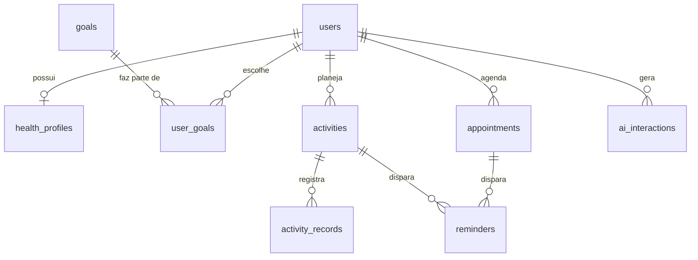

# Banco de dados

PostgreSQL 17. O schema fica em [V1__schema_inicial.sql](../backend/src/main/resources/db/migration/V1__schema_inicial.sql) e é aplicado pelo Flyway. O Hibernate só valida se as entidades batem com ele (`ddl-auto: validate`).

| Tabela | Finalidade | Classificação (Política, item 14) |
|---|---|---|
| `users` | Conta, data de nascimento e consentimento | Cadastral |
| `health_profiles` | Nível de atividade e observações | Potencialmente sensível |
| `goals` | Catálogo de objetivos | Sem dado pessoal |
| `user_goals` | Objetivos de cada usuário (N:N) | Potencialmente sensível |
| `appointments` | Consultas, exames e outros compromissos | Rotina / potencialmente sensível |
| `activities` | Atividades planejadas por dia da semana e horário | Rotina |
| `activity_records` | Atividades realizadas ou não, por dia | Rotina |
| `reminders` | Lembretes de um compromisso ou de uma atividade | Rotina |
| `ai_interactions` | Métricas de uso da IA, sem o texto enviado ou gerado | Rotina |

## Decisões de normalização

- **Idade:** não é armazenada. Guardamos `birth_date` e calculamos a idade, que é um dado derivado.
- **Objetivos:** ficam em `goals` e `user_goals`, em vez de uma lista dentro de `users` (1FN).
- **Atividades recorrentes:** cada horário semanal é uma linha de `activities` ("caminhada, segunda, 10:00"), e cada execução é uma linha de `activity_records`.
- **Lembretes:** não têm `user_id`, porque o usuário já é determinado pelo compromisso ou pela atividade (3FN). Um `CHECK` exige exatamente um dos dois. Isso difere do desenho conceitual da Política (`users → reminders`).

## Regras garantidas pelo banco

- E-mail único, sem diferenciar maiúsculas de minúsculas.
- Valores válidos para tipos e status, por `CHECK`.
- O mesmo lembrete não pode ser criado duas vezes.
- Apagar um usuário apaga todos os dados dele, em cascata (LGPD).
